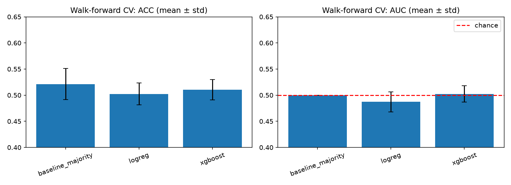
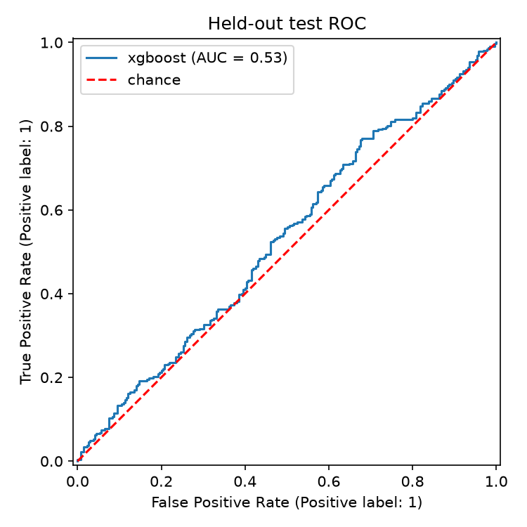

# Apple Stock Price Movement Prediction

Next-day direction (up/down) classification for AAPL, built as a reproducible pipeline with leakage-safe evaluation.

> **Headline result:** under walk-forward validation and a chronological held-out test, no model shows statistically meaningful skill over the majority-class baseline. See [Results](#results).

## Overview

- **Task:** predict whether `Close(t+1) > Close(t)` using only information available at close of day `t`.
- **Data:** daily OHLCV for AAPL from 2015-01-01, downloaded with `yfinance` (split/dividend adjusted) and cached as parquet.
- **Models:** majority-class baseline, logistic regression (scaled), XGBoost (regularized).
- **Evaluation:** walk-forward cross-validation on the development window, then a single score on a chronologically held-out test window.

## Methodology

| Concern | Approach |
|---|---|
| Train/test split | Chronological: first 80% development, last 20% held-out test. No shuffling. |
| Cross-validation | `TimeSeriesSplit` (5 folds, expanding window). |
| Scaling leakage | `StandardScaler` lives inside the sklearn `Pipeline`, fit on training folds only. |
| Label construction | `shift(-1)` target; the final row (no next day) is dropped rather than labeled `0`. |
| Look-ahead in features | Every feature uses data up to day `t` only. Enforced by tests. |
| Baselines | Majority-class `DummyClassifier`. Models must beat it to count. |
| Model selection | By mean CV AUC on the development window only. The test set is scored once. |

### Features

| Feature | Description |
|---|---|
| `ret_1`, `ret_5`, `ret_10` | Trailing returns over 1, 5, 10 days |
| `vol_10` | 10-day rolling std of daily returns |
| `vol_change` | Daily percent change in volume |
| `rsi_14` | 14-day RSI |
| `ma_ratio_10_30` | 10-day MA / 30-day MA − 1 |
| `range_pct` | (High − Low) / Close |
| `gap_pct` | Open / previous Close − 1 |
| `dow` | Day of week |

## Results

Run date: 2026-10-16. Dev window: 2,348 rows. Held-out test window: 587 rows.

**Walk-forward CV (development window, mean ± std over 5 folds):**

| Model | Accuracy | AUC |
|---|---|---|
| Majority baseline | 0.521 ± 0.030 | 0.500 |
| Logistic regression | 0.502 ± 0.021 | 0.487 ± 0.019 |
| XGBoost | 0.511 ± 0.020 | 0.502 ± 0.016 |

**Held-out test (XGBoost, selected by CV AUC):**

| Metric | Value |
|---|---|
| Accuracy | 0.557 |
| Majority-class baseline accuracy | 0.549 |
| AUC | 0.532 |
| n | 587 |

### Interpretation

- Neither model beats the baseline in CV. Logistic regression's AUC is below 0.5 and XGBoost's is within one standard deviation of 0.5.
- On the test window, the +0.85 pp accuracy gain over baseline is far inside sampling noise (standard error is roughly 2 pp at n=587). AUC 0.532 has a standard error of roughly 0.024, so it is not distinguishable from chance, especially given that the model was chosen from a small candidate set.
- An earlier version of this project (single notebook, shuffled 90/10 split, 51 validation rows) reported validation AUC up to 0.61. That figure came from temporal leakage and a tiny validation set. It does not survive proper evaluation.

Predicting next-day direction of a single, highly liquid stock from price/volume history is expected to be close to a coin flip. This repository's value is the evaluation methodology, not a trading signal.




Additional figures (`price.png`, `correlation.png`, `confusion.png`, `feature_importance.png`) are written to `reports/figures/` on every run.

## Project Structure

```
Stock-Price-Prediction/
├── README.md
├── pyproject.toml
├── .gitignore
├── data/                      # cached price data (gitignored)
├── models/                    # trained artifacts + metrics.json (gitignored)
├── reports/figures/           # generated plots
├── notebooks/                 # exploratory notebook(s)
├── src/stock_prediction/
│   ├── config.py              # run configuration
│   ├── data.py                # download, validation, caching
│   ├── features.py            # leakage-safe feature + target construction
│   ├── models.py              # model factory (pipelines)
│   ├── evaluate.py            # walk-forward CV and metrics
│   ├── plots.py               # figure generation
│   └── train.py               # CLI entry point
└── tests/
    └── test_no_leakage.py     # look-ahead and label-correctness tests
```

## Getting Started

Requires Python 3.10+ and internet access on first run (data download).

```bash
# Git Bash / macOS / Linux
python -m venv .venv
source .venv/Scripts/activate        # macOS/Linux: source .venv/bin/activate
pip install -e ".[dev]"
```

```powershell
# PowerShell
python -m venv .venv
.venv\Scripts\Activate.ps1
pip install -e ".[dev]"
```

Run all commands from the project root (paths in `config.py` are relative).

### Test

```bash
pytest -q
```

### Train and evaluate

```bash
train
# equivalent: python -m stock_prediction.train
```

Outputs:

- `models/<best_model>.joblib` and `models/metrics.json`
- `reports/figures/*.png`
- Walk-forward CV table and held-out metrics in the console log

### Configuration

Edit defaults in `src/stock_prediction/config.py`:

| Field | Default | Meaning |
|---|---|---|
| `ticker` | `AAPL` | Symbol to download |
| `start` / `end` | `2015-01-01` / latest | Date range |
| `test_fraction` | `0.2` | Share of most recent rows held out |
| `n_splits` | `5` | Walk-forward folds |
| `seed` | `42` | Random seed |

## Testing

`tests/test_no_leakage.py` verifies that:

1. The final row is dropped and no target is NaN.
2. Features at day `t` are unchanged when future rows are removed (no look-ahead).
3. The target equals the next-day direction of `Close`.

## Limitations

- Single ticker, ~2,900 daily observations: small sample for a low signal-to-noise problem.
- Features are price/volume-derived only. No fundamentals, macro, or sentiment data.
- No transaction costs or backtest. Classification accuracy does not imply tradability.
- Test-set conclusions rest on 587 observations and carry wide uncertainty.

## Roadmap

- [ ] Backtest module: long/flat strategy with costs, Sharpe, max drawdown vs. buy-and-hold
- [ ] Multi-ticker training for a larger sample
- [ ] Alternative targets: multi-day horizon, thresholded returns, volatility prediction
- [ ] Probability calibration and abstention on low-confidence days
- [ ] Hyperparameter search inside walk-forward CV
- [ ] Experiment tracking (MLflow / W&B)
- [ ] CI workflow (lint + tests)

## Disclaimer

This project is for educational and research purposes only. It is not financial advice, and nothing here should be used to make investment decisions.